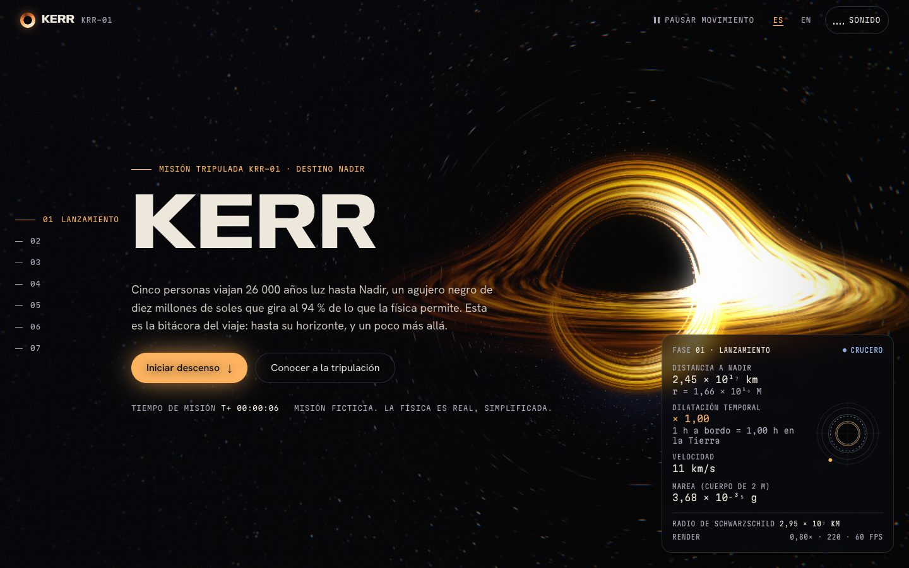
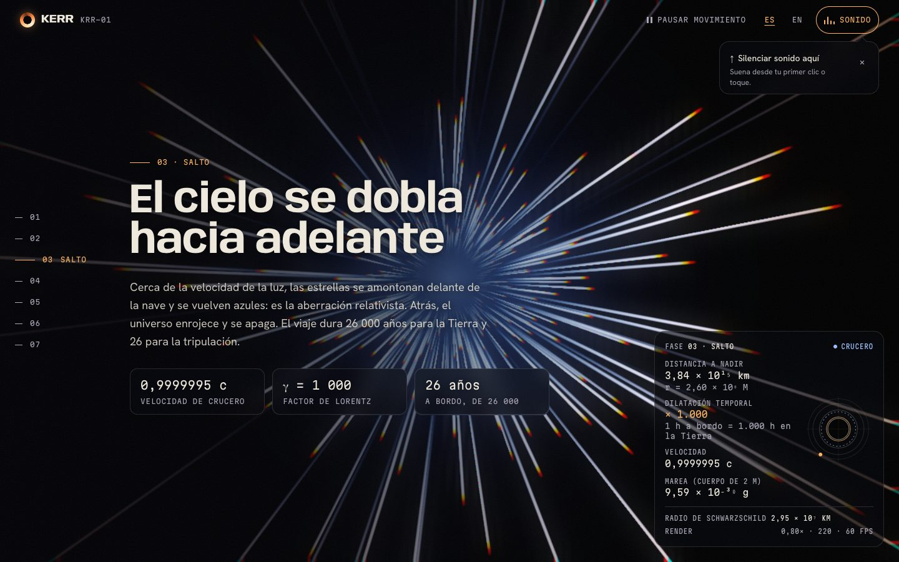
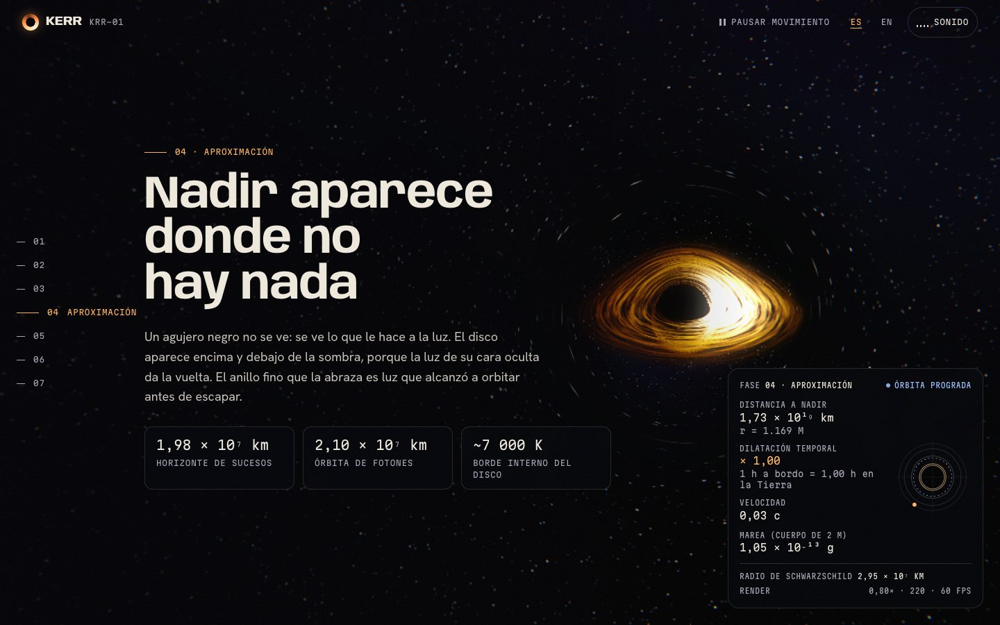
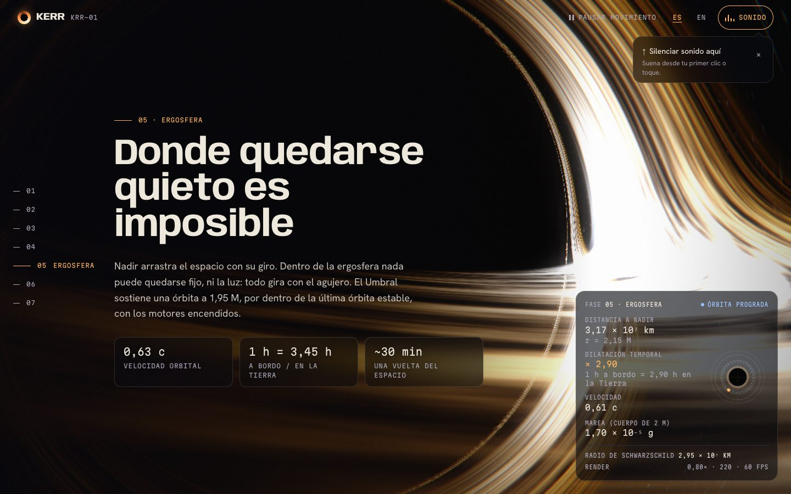
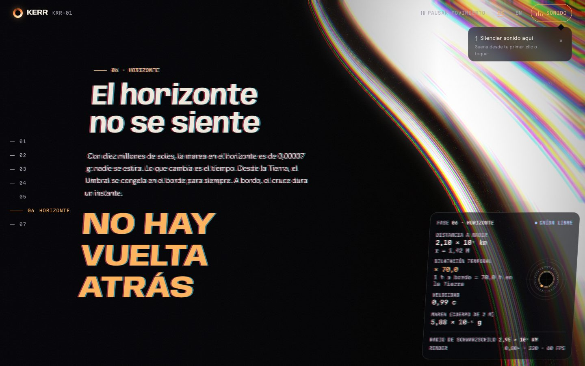
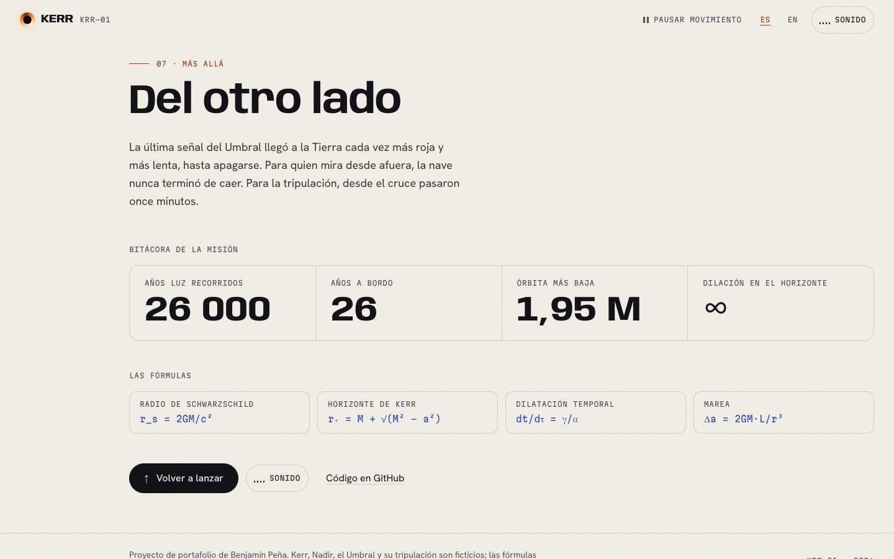
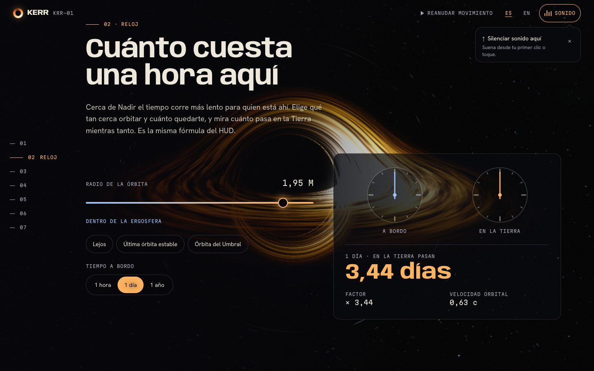
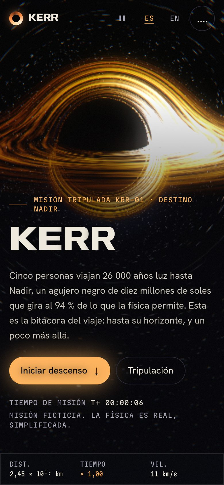
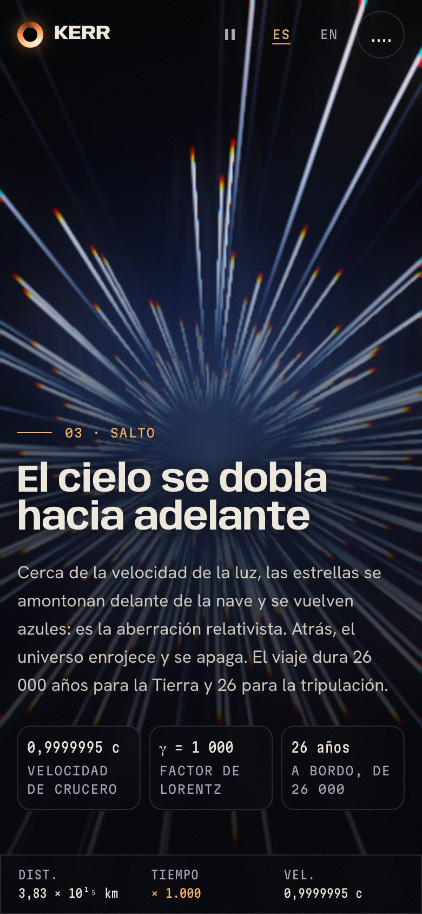
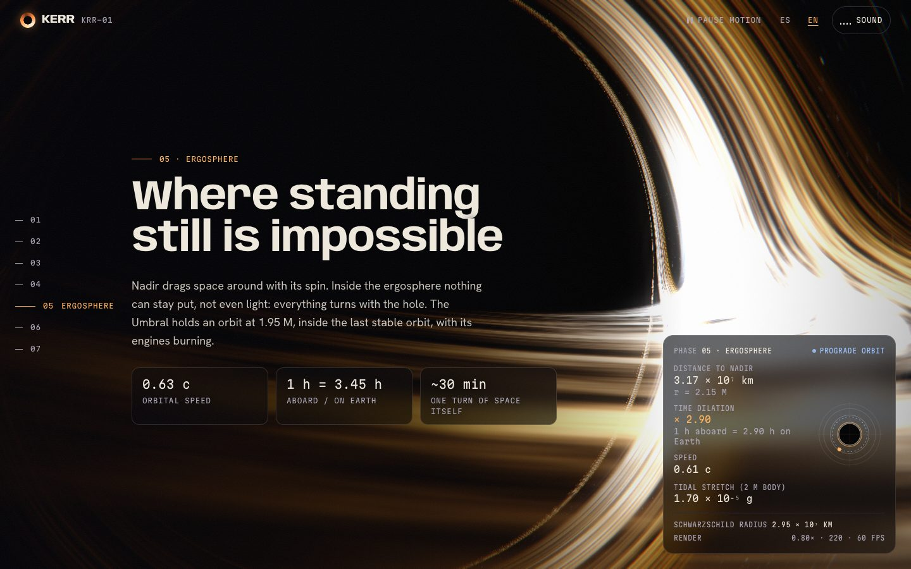

# Kerr

The site of a fictional crewed mission into a spinning black hole. Five
people, one ship (the *Umbral*) and Nadir: ten million suns, spinning at 94 %
of what physics allows. The scroll is the flight, in seven chapters: launch,
crew, a relativistic jump, the approach, an orbit inside the ergosphere, the
crossing of the event horizon, and what is on the other side.

The black hole is rendered live in WebGL2: every pixel traces a ray of light
bending around the hole. The numbers on the HUD come from real formulas.

Kerr, Nadir, the Umbral and its crew are invented, and the page says so. The
formulas are not.



---

## Contents

- [The flight](#the-flight)
- [Stack](#stack)
- [The black hole](#the-black-hole)
- [The physics on the HUD](#the-physics-on-the-hud)
- [Design direction](#design-direction)
- [Nothing gets cut off](#nothing-gets-cut-off)
- [Accessibility](#accessibility)
- [Performance](#performance)
- [Running it](#running-it)

---

## The flight

| Chapter | What happens |
|---|---|
| 01 Launch | Nadir in the distance, its disk lensed above and below the shadow. A wordmark whose letters swell on Anybody's width and weight axes near the cursor and stutter now and then. The mission clock starts. |
| 02 Crew | Five crew members on a carousel with depth: drag it, use the arrows or the keys. Each portrait is drawn: a helmet whose visor reflects Nadir in that person's colour. |
| 03 Jump | At 0.9999995 c: star streaks rushing past, blue ahead and red at the edge, with chromatic aberration. γ = 1,000. |
| 04 Approach | From a speck to a wall of light. The far side of the disk shows over the top of the shadow; the photon ring hugs it. |
| 05 Ergosphere | The camera swings around the hole inside the last stable orbit, the disk sweeping through the frame. |
| 06 Horizon | Everything stretches: the picture twists and pulls, the copy shears and splits into colour, the last words widen on the font's width axis, the HUD goes to ∞ and loses the signal. Then white. |
| 07 Beyond | The page turns to paper: the mission log, the formulas, and a way back to the launch. |








Around it: a HUD with live telemetry and a radar of the ship against the
horizon, the photon orbit and the ergosphere; a chapter rail; a custom
cursor; magnetic buttons; and **an optional score**, synthesised live with
Web Audio, original, in the spirit of the big space-organ film scores. The
flight is a cathedral organ (additive ranks from a 16' pedal to mixtures,
in a long synthetic nave) holding a pedal A under slow chords; a clock whose
tick stretches with the time dilation on the HUD and stops at the horizon; a
rocking two-note figure that enters in the ergosphere and speeds up through
the dive; one long crescendo, cut dead at the crossing. The other side is
calm: a choir of soft "ah" voices (detuned saws through vowel formants) on a
wide major chord, and small bells far apart in a much longer hall. It only starts from its button, never on its own.

---

## Stack

| Purpose | Choice |
|---|---|
| Build | Vite 8, static prerender of the HTML |
| UI | React 19, TypeScript 6 in strict mode |
| Styling | Tailwind CSS v4, tokens in `src/index.css` |
| Black hole | Raw WebGL2: a ray-marching shader plus bloom and composite passes, lazy-loaded (9 KB gzip) |
| Scroll and motion | GSAP 3 + ScrollTrigger, Lenis, one shared `requestAnimationFrame` |
| Sound | Web Audio: organ, clock and ostinato synthesised live, nothing to download |
| Checks | Vitest, `@axe-core/playwright`, Lighthouse, a clipping check, oxlint, Prettier |

---

## The black hole

**Light, bent step by step.** `src/webgl/shader.ts` fires a ray from the
camera through each pixel and integrates it as a Schwarzschild null geodesic,
written as an acceleration (`a = −(3/2)·h²·x/r⁵`, with `r_s = 1`) and stepped
with leapfrog. A Lense–Thirring term twists each ray around the spin axis:
that is what makes the shadow flatten on one side and the disk image go
lopsided, the signature of a rotating hole. It is an honest approximation of
a Kerr hole, not a full Kerr integrator.

**The disk.** Wherever a ray crosses the equator inside the disk, it picks up
light. The gas follows a thin-disk temperature profile (`T ∝ r^−3/4`), orbits
at Keplerian speed, and is shifted by Doppler beaming and gravitational
redshift (`g = δ·√(1 − r_s/r)`, intensity `∝ g³`, colour from a black-body
fit at `T·g`). So one side burns blue-white and the other fades to red.
Because rays keep going after a crossing, the far side of the disk shows over
the top and under the bottom of the shadow, with a thin photon ring around
it. The turbulence is two copies of the pattern, each reset on its own
half-period and crossfaded, so it orbits forever without winding up.

**The sky is lensed for free.** Rays that escape sample a procedural sky in
their final direction, so stars near the hole stretch into arcs (that is real
lensing: from 20 r_s away the Einstein radius is large).

**Three passes.** The march draws into a texture below canvas resolution; its
bright parts are blurred twice at a quarter of that, for bloom; a composite
pass upscales, adds the bloom, a radial chromatic aberration that grows
during the jump and the dive, a vignette and dither.

**Quality adapts.** From the GPU the browser reports, it picks a tier (render
scale, march steps, noise octaves). Then every half second it looks at frame
times: sustained frames over 22 ms lower the render scale, then the steps and
octaves; sustained headroom buys the resolution back. The HUD shows it live
(`Render 0,80× · 220 · 60 fps`). The renderer loads only after the page is
idle, over a still poster that also stands in when WebGL2 is missing.

---

## The physics on the HUD

`src/mission/physics.ts`, in geometric units (M = GM/c²), for Nadir:
10⁷ M☉, a = 0.94. Pinned by `physics.test.ts`, including the Schwarzschild
limits.

| Reading | Formula |
|---|---|
| Schwarzschild radius | `r_s = 2GM/c²` = 2.95 × 10⁷ km |
| Event horizon | `r₊ = M + √(M² − a²)` = 1.341 M |
| Photon orbit, ISCO | Bardeen, Press & Teukolsky (1972): 1.424 M, 2.024 M |
| Time dilation, cruising | `γ/α` (special relativity over the lapse) |
| Time dilation, in orbit | `u^t = (r^{3/2} + a)/(r^{3/4}·√(r^{3/2} − 3r^{1/2} + 2a))` |
| Orbital speed | as a locally non-rotating observer measures it (BPT 1972) |
| Free fall | `v = √(1 − α²)`, `dt/dτ = 1/α²`, both reaching their limit at r₊ |
| Tidal stretch | `Δa = 2GM·L/r³` over a 2 m body |

The prose uses the same numbers: the orbit at 1.95 M runs at 0.63 c with
1 h aboard = 3.45 h on Earth, and the tidal stretch at the horizon is
0.00007 g, which is why the crew feels nothing.

---

## Design direction

**«Horizonte»: ivory on void, and all colour from the hole.** The interface
is monochrome; the disk's amber gives the accent (`plasma`, interactive
only) and its blue shift the instruments (`corrimiento`). After the horizon
the whole page turns to paper, the light chapter. Glass panels after the
cinematic-site genre (GetLayers was the reference), built from scratch.

- **Type:** Anybody on its width and weight axes for display (the kinetic
  wordmark and the widening words at the horizon animate the axes, not a
  scale), Hanken Grotesk for text, Martian Mono for the instruments (its
  width axis condenses the HUD on phones).
- **One easing** for the page, `cubic-bezier(0.22, 1, 0.36, 1)`.

| Token | Hex | Role |
|---|---|---|
| `--color-vacio` | `#04050a` | ground |
| `--color-marfil` | `#efe9dd` | text |
| `--color-polvo` | `#a9a5b6` | secondary text |
| `--color-plasma` | `#ffb35c` | interactive only |
| `--color-corrimiento` | `#9cc2ff` | instruments |
| `--color-papel` / `--color-carbon` | `#f2eee6` / `#0e0d13` | the light chapter |
| `--color-brasa` | `#a3390a` | interactive, light chapter |

---

## Nothing gets cut off

`scripts/clip-check.mjs` walks the mission at six sizes (1440×900, 1280×720,
1024×768, 768×1024, 375×667, 360×640), stopping three times inside each
pinned chapter, screenshots each stop and measures every visible text node's
glyph box. It fails on horizontal page scroll, text clipped by an ancestor or
a `clip-path`, text past the viewport edge or out of its card, text above the
screen in a pinned panel, and text under the header or the HUD while its
panel is pinned. Both builds (motion and reduced) pass at every size.

What makes that hold:

- A pinned chapter is exactly one screen tall. Each one measures its own
  copy, and if it needs more (a short phone, a large text setting) it
  unpins and scrolls like a normal section, rather than cut anything.
- On wide screens the copy column reserves the HUD's column.
- Display type keeps a line-height of 0.95 or more and a little padding;
  the wordmark is sized for its widest state (wdth 150, wght 900).
- The glitch copies are offset, never masked; the real text is always whole.
- Figures keep their units with non-breaking spaces and break only at `×`.

---

## Accessibility

- **axe-core: 0 violations** in seven runs: desktop and phone, Spanish and
  English, mid-crossing at the horizon, the light chapter on a phone, and the
  reduced build on both.
- **Reduced motion is a real version.** With `prefers-reduced-motion`, or
  `?reduced=1`: no smooth scroll, no cursor, no glitch, no pinning. The black
  hole renders one still per chapter, at full quality, when the chapter
  changes. The crew is a grid. The HUD updates per chapter.

  

- **A pause switch** in the header reloads into that version (WCAG 2.2.2).
- The carousel is a labelled region: only the front card is exposed, the
  rest are `inert`, and changes are announced politely once the visitor
  moves it.
- The canvas, the poster, the glitch copies and the kinetic letters are
  `aria-hidden`; the wordmark is read as one label. The HUD is a labelled
  complementary region whose readings are a description list.
- `lang` follows the language switch. Skip link, 2 px focus ring, 44 px
  targets. The sound button is a toggle (`aria-pressed`).

---

## Performance

Lighthouse 12 against `vite preview` (no compression; Vercel adds it):

| Run | Performance | Accessibility | Best practices | SEO |
|---|---|---|---|---|
| Desktop | 100 | 100 | 100 | 100 |
| Mobile (simulated 4× CPU, slow 4G) | 90 | 100 | 100 | 100 |

Desktop: LCP 0.7 s, TBT 50 ms, CLS 0.002. Mobile: LCP 3.1 s, TBT 0 ms,
CLS 0.03. The shader compiles after `load`, when the page is idle.




---

## Running it

```bash
npm install
npm run dev
```

| Script | What it does |
|---|---|
| `npm run dev` | dev server on `:5173` |
| `npm run build` | typecheck, client build, SSR build, prerender |
| `npm run preview` | serve the production build |
| `npm test` | Vitest: the physics and the number formatting |
| `npm run lint` | oxlint |
| `npm run format` | Prettier |
| `npm run capture` | regenerate `docs/`, `public/og.jpg` and `public/poster.webp` (needs `npm run dev`) |
| `npm run clip` | the clipping check at six sizes (needs `npm run dev`) |
| `npm run a11y` | axe over seven builds (needs `npm run preview -- --port 4173`) |

The checks take the URL as their first argument; `clip` takes an output
folder and a query second and third, e.g.
`node scripts/clip-check.mjs http://localhost:5173 /tmp/clip '?reduced=1'`.

`?reduced=1` forces the reduced build, `?reduced=0` forces motion. In
development, `?t=4.4` freezes the mission clock at that point of the flight.

### Deploying

Live at **https://kerr-mission.vercel.app**. The Vercel project
`kerr-mission` is connected to this repository: every push to `main` deploys
to production. `vercel.json` sets the Vite preset, `dist`, and a year of
cache for hashed assets. No environment variables, no runtime.



---

## License

[MIT](LICENSE). Fonts under the SIL Open Font License (Anybody, Hanken
Grotesk, Martian Mono).
